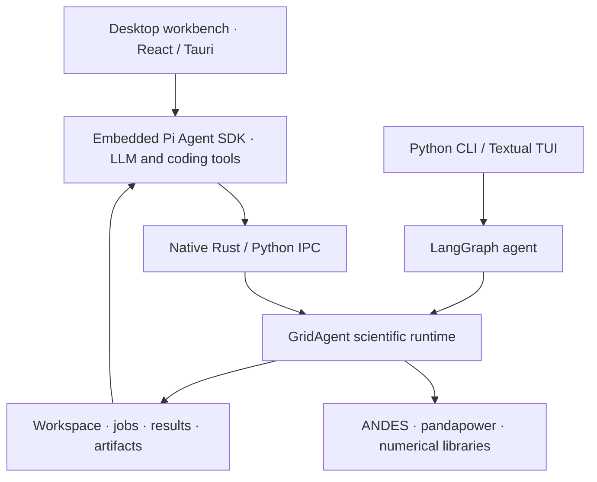

<p align="center">
  
</p>

<h1 align="center">GridAgent</h1>

<p align="center">
  <strong>An open-source scientific coding agent for power systems, electrical engineering, and energy storage.</strong>
</p>

<p align="center">
  <a href="ROADMAP.md">Roadmap</a> ·
  <a href="docs/architecture.md">Architecture</a> ·
  <a href="integration/proliferate/README.md">Desktop development</a> ·
  <a href="https://github.com/kevenhu001-cyber/GridAgent/issues">Issues</a>
</p>

> **Early development:** The Windows desktop is under active integration. The Python CLI and TUI are available for development and research; a production-ready desktop installer has not yet been validated.

## What is GridAgent?

GridAgent is an LLM-first engineering workspace designed to help researchers and engineers formulate physical and mathematical models, write simulation code, run professional numerical solvers, inspect results, and iteratively improve their experiments.

Unlike a conventional expert system, GridAgent leaves the choice of modeling approach, algorithms, experiments, and next actions to the language model. The application supplies the tools, scientific libraries, workspace, execution environment, and evidence needed to carry out that work.

## Capabilities

| Capability | Scope |
| --- | --- |
| Power-system modeling | Network inspection, AC power flow, topology analysis, contingency scenarios and dynamic simulation |
| Scientific computation | Numerical methods, optimization, control analysis and parameter studies |
| Engineering solvers | ANDES and pandapower as core backends; additional libraries installable on demand |
| Scientific coding | Embedded Pi coding tools and native scientific IPC in the desktop development runtime |
| Research workspace | Local sessions, model files, run artifacts, numerical results and reproducible study records |
| Desktop workbench | Retained React/Tauri chat, model selection, settings, workspace and file-management UI |
| Knowledge and verification | Engineering documentation, evidence-backed comparisons, and optional benchmark and research workflows |

General autonomous code execution, durable tool context, comprehensive scientific visualization and full desktop integration remain active development areas. See the [roadmap](ROADMAP.md) for acceptance criteria and limitations.

## Architecture



The desktop reuses the preserved Proliferate workbench and embeds Pi as its designated Agent engine. GridAgent's scientific tools are integrated through first-party native interfaces, rather than requiring MCP for internal communication. MCP remains available for optional external interoperability. The Python CLI/TUI currently retain their existing LangGraph loop.

The diagram describes the intended product architecture with development-stage integrations; the remaining external Agent paths are scheduled for removal before production release.

## Getting started

### Python CLI / TUI

Requires Python 3.11–3.13. Clone the repository and create a virtual environment:

```bash
git clone https://github.com/kevenhu001-cyber/GridAgent.git
cd GridAgent
python -m venv .venv
```

**Windows PowerShell**

```powershell
.\.venv\Scripts\Activate.ps1
python -m pip install -e ".[core]"
$env:GRIDAGENT_MODEL = "your-tool-capable-model"
$env:GRIDAGENT_API_KEY = "your-api-key"
# Optional for an OpenAI-compatible provider:
# $env:GRIDAGENT_BASE_URL = "https://openrouter.ai/api/v1"
gridagent
```

**Linux / macOS**

```bash
source .venv/bin/activate
python -m pip install -e ".[core]"
export GRIDAGENT_MODEL="your-tool-capable-model"
export GRIDAGENT_API_KEY="your-api-key"
# Optional: export GRIDAGENT_BASE_URL="https://openrouter.ai/api/v1"
gridagent
```

The Python agent currently uses OpenAI-compatible provider configuration. Keep credentials local and never commit them.

Example one-shot request:

```bash
gridagent --ask "Inspect the Kundur case and run a power flow."
```

For sessions, model imports, research tasks and result inspection, see the [general agent guide](docs/general-agent.md), [workspace guide](docs/workspace.md) and [research workflows](docs/research-tasks.md).

### Windows desktop (development)

The desktop source is in [vendor/proliferate](vendor/proliferate). Development requires Node.js 22.19.0, pnpm 10.11.0, Rust with the x86_64 Windows MSVC target, Windows SDK, and Python with the core scientific dependencies.

See the [desktop integration guide](integration/proliferate/README.md) for environment variables, locked dependency installation, build checks, and development-mode native runtime setup.

A packaged, clean-machine-tested Windows installer is not yet available as a validated release.

## Scientific libraries

| Core | Optional managed backends |
| --- | --- |
| ANDES, pandapower | PyPSA, OpenDSS, PYPOWER, PyPowSyBl |
| NumPy, SciPy, SymPy | CVXPY, Pyomo, CasADi, OSQP |
| HiGHS, Python Control | PyBaMM, pvlib, windpowerlib |
| pandas, NetworkX | scikit-rf, CoolProp, rainflow |

The Python CLI can inspect and manage optional backends:

```bash
gridagent --plugins
gridagent --plugin-install pypsa
```

See [native backends](docs/native-backends.md) and [plugin management](docs/plugins.md) for supported operations and limitations. Commercial adapters require their own installed and licensed environments; they are not represented as production-validated integrations.

## Repository structure

```text
GridAgent/
├── vendor/proliferate/   # Preserved React/Tauri desktop workbench
├── src/gridagent/       # Python agent and scientific runtime
├── integration/        # Desktop runtime integration and setup
├── desktop/branding/   # GridAgent product assets
├── examples/           # Example research inputs
├── tests/              # Python tests and research validation
├── docs/               # Architecture and engineering documentation
└── ROADMAP.md          # Active development plan
```

## Development and contributing

```bash
python -m pip install -e ".[dev,core]"
pytest -m "not integration"
pytest -m integration
```

Read [AGENTS.md](AGENTS.md), the [LLM-first architecture decision](docs/adr/0001-llm-first.md), and the [native scientific runtime decision](docs/adr/0003-native-scientific-runtime.md) before contributing. Reuse existing desktop components and scientific services rather than creating parallel implementations. Validate numerical claims using actual solver results and distinguish development tests from real end-to-end execution.

## License and acknowledgments

GridAgent's original Python core is licensed under [GPL-3.0-or-later](LICENSE). The preserved Proliferate 0.4.27 desktop source is licensed under [AGPL-3.0](vendor/proliferate/LICENSE). See the [upstream notices](vendor/proliferate/THIRD_PARTY_NOTICES.md) and [integration guide](integration/proliferate/README.md) for provenance and attribution. Combined distribution must comply with applicable license obligations.

GridAgent is an independent research application, not a certified engineering system or an operational power-grid controller. Numerical convergence does not establish physical validity; engineering results require appropriate independent review.

Developed by **TopoDrive**. Lead developer: **Adex Hu**.
