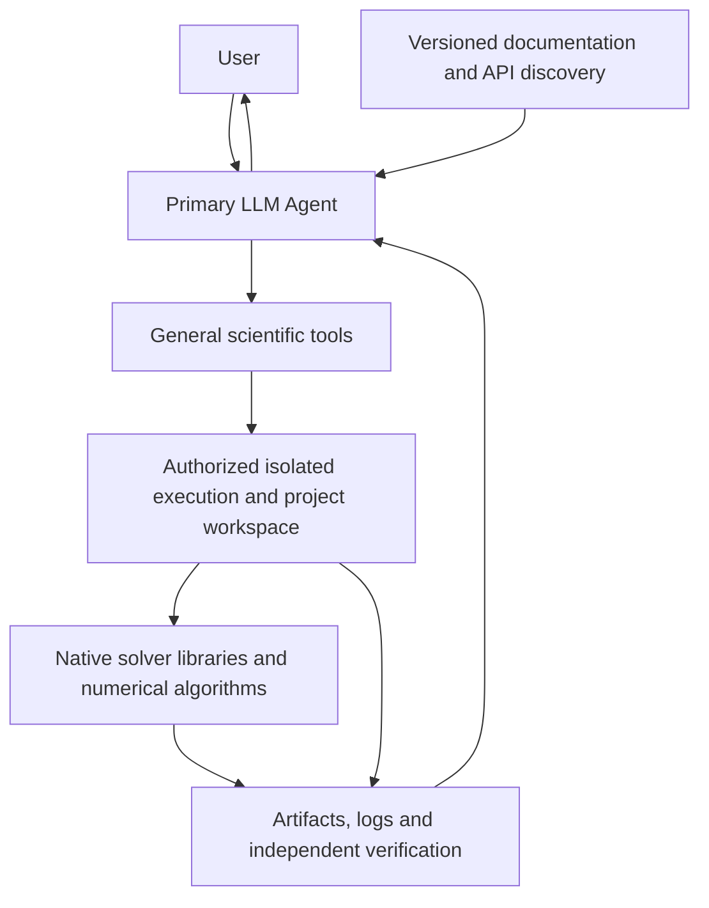

# ADR 0001: LLM-first scientific coding and execution platform

- Status: Accepted — product owner direction, 2026-11-27
- Scope: default architecture, all future development and review
- Supersedes: conflicting portions of the 2026-11-26 PGHA roadmap and fixed research-loop proposals

## Context

GridAgent already has a LangGraph LLM tool loop, professional simulation libraries, local plugins, typed modeling interfaces, evidence storage and native desktop workbench. Subsequent research work introduced deterministic diagnostic and experiment-selection policies, narrow solver wrappers and fixed workflows. Those are useful experiments but are not a substitute for general agentic modeling. In particular the normal chat path currently drafts Python rather than freely executing it; existing automatic Windows Sandbox research is specialized for AC reference comparison. These are capability gaps, not intended permanent product boundaries.

## Decision

GridAgent is the electrical engineering equivalent of a coding agent: the LLM is the primary intellectual actor; the application is its scientific computing platform. It must be possible for the model to solve a new task through code, native library APIs, documentation and iterative feedback without a developer implementing the solution procedure beforehand.

| LLM owns | Runtime owns | Scientific libraries own |
| --- | --- | --- |
| Interpret requirements, clarify and formulate model | Workspace grants, sandbox, resource budgets, cancellation | Numerical integration, linear algebra, power flow |
| Write and revise code, choose methods and experiments | Tool discovery, execution, logs, versioning, artifacts | Optimization, symbolic computation, specialized physics |
| Interpret failures and results; plan next actions | Independent checks and evidence provenance, not research direction | Return numerical results and diagnostics |

A deterministic algorithm may solve an explicitly formulated subproblem, and the LLM may choose to run a fixed workflow. Neither establishes a mandatory expert-system controller. Verification constrains what can be claimed, not which research strategy the model must pursue. The LLM is not expected to numerically solve equations itself.

## Design consequences

- General programming and native library access are the primary path. Typed wrappers, IR and template studies are complementary conveniences, not gates to the full API.
- Use a persistent per-project code/data environment. Execute through OS-grade isolation with scoped input/output and no ambient secrets; support user-authorized permissions, bounded resources, cancellation, meaningful error output and inspectable artifacts. No unrestricted host shell. No automatic package install or network access without consent.
- One LLM-led interaction loop across clients. Task journals may schedule delegated computations but may not become a second autonomous research controller.
- Retain numerical solvers, optimizers, independent checks, plugin isolation, scientific visualization and durable evidence. Keep existing domain heuristics and trained policies opt-in; do not add more fixed domain controllers as default product features.
- The normal research experience should not require users to assemble candidate JSON or select a prebuilt recipe for an unfamiliar question.
- Test previously unseen tasks requiring code authoring, native API use, failure recovery and meaningful deliverables. Record actual runs and distinguish numerical convergence, independent validation and engineering adequacy.

## Migration

Review PR #6 (workbench and collection), #7 (numerical references and dynamic benchmark) and #8 (fixed closed loop and policy comparison) individually. Retain generic infrastructure and useful numerical tools after tests; do not integrate #8's deterministic closed loop as the default agent. Older merged diagnostic, adaptive and decision-model modules may remain as opt-in experiments while dependencies and migration are reviewed. This ADR does not merge, close or delete those PRs or modules.

See [repository instructions](../../AGENTS.md) and [active roadmap](../../ROADMAP.md). Changes to this decision require explicit owner approval.
