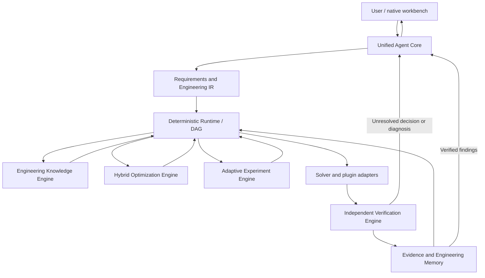

# Historical roadmap — superseded 2026-11-27

**Archive only. Not active development instructions.** The LLM-first owner direction in [ADR 0001](../adr/0001-llm-first.md), [AGENTS.md](../../AGENTS.md) and [the current roadmap](../../ROADMAP.md) supersedes conflicting requirements below. Preserve this record for historical research context; do not implement its mandatory decision policies or milestones as the current plan.

# GridAgent 2.0 — Development Roadmap

**Owner:** TopoDrive / GridAgent  
**Adopted:** 2026-11-26  
**Architecture:** Physics-Grounded Hybrid Agent Architecture (PGHA)  
**Status:** Approved direction; milestones remain pending until their acceptance gates are met.  
**Reviewed baseline:** PR #2 at `7c65eaf3407d533f5e316e574468d9c6e7412f96` (reviewed development snapshot, not a statement that it has merged).

This roadmap supersedes the earlier incremental Agent roadmap as the direction for future development. Existing architecture and benchmark documents remain useful records of their respective implementation and experimental protocols.

## 1. Product and research objective

GridAgent is an offline-capable power-system and energy-storage research workbench for autonomous modeling, simulation, diagnosis and optimization. It should organize **verifiable engineering experiments**, rather than merely translate natural language into simulator commands.

> Let the LLM organize experiments, numerical algorithms perform computation, and independent evidence determine conclusions.

Adopt one logical Agent with a shared engineering state, deterministic execution, professional solvers, numerical optimization, and independent verification. Draw on the structured retrieval and feedback mechanisms of Jia et al. and the constrained engineering benchmarks of PowerAgentBench-Dyn without making inter-agent LLM communication the default.

GridAgent is a research and engineering-analysis application, not a certified engineering system or a live grid controller. All performance improvements and research contributions must be demonstrated experimentally.

## 2. Architectural decisions

| ID | Decision | Consequence |
| --- | --- | --- |
| ADR-01 | Single logical Agent | One task policy, context manager and shared state; no mandatory planner/retriever/coder/reviewer LLM conversations. |
| ADR-02 | Deterministic first | Prefer rules, typed contracts, graph algorithms, solvers and optimizers whenever applicable. LLM handles ambiguity, hypotheses, high-level decisions and synthesis. |
| ADR-03 | Explicit engineering contracts | Separate requirements, model, scenarios, plan, constraints, budgets and evidence. Communicate through versioned structured objects, not agent-to-agent prose. |
| ADR-04 | Independent verification | The proposing LLM cannot certify its own work. Solver success, requirement fidelity, numerical correctness, physical validity and operating limits are distinct. |
| ADR-05 | Reproducible experiments | Immutable model revisions, run inputs, simulator versions, configuration, artifacts and evaluator versions. Cache only when equivalence is established. |
| ADR-06 | Bounded autonomy | Explicit user authorization, resource budgets, allowed operations, safe stopping, cancellation and auditable revisions. |
| ADR-07 | Local-first modular execution | Preserve native Windows, TUI and CLI over shared Python domain logic. Parallelize computational workers, not LLM personalities. |
| ADR-08 | Progressive capability | Do not add a universal simulation language, distributed service fleet, marketplace, mandatory vector database or trained policy without a demonstrated need. |

A bounded independent model review or provider switch may be an explicit optional operation within the same task state; it must not become an autonomous competing controller. Keep existing multi-agent research variants only as clearly labeled comparison baselines until migration and experimental parity are established.

## 3. Target architecture

The LLM is invoked at decision boundaries, not at every computational step. A single plan may schedule many independent simulations or optimization iterations without repeated LLM calls. Verification results feed the runtime; the LLM is consulted when a new engineering decision is necessary.

### 3.1 Unified Agent Core

Own intent interpretation, requirement clarification, hypothesis generation, plan creation, exception-driven re-planning and evidence-grounded reporting. Maintain one canonical task context and a capability snapshot for each execution epoch.

Use a persistent state machine such as:

`draft -> needs_clarification / awaiting_approval -> planned -> running -> verifying -> completed / partial / failed / cancelled`

Re-planning must create a new plan revision without silently changing locked requirements. A user approval is scoped to the exact action, model revision and authorized range. Distinguish a task that completed with adverse physical findings from a task that failed to execute.

### 3.2 Engineering IR and compiler

Use separate versioned contracts rather than one monolithic schema:

| Contract | Responsibility |
| --- | --- |
| RequirementSpec | Original request, explicit quantities and units, objectives, required outputs, locked fields, assumptions and provenance. |
| ModelIR | Stable device IDs, buses, connections, parameters, units, base quantities, model family and revision. |
| StudySpec | Operating points, events, solver class, time horizon, fidelity, requested observables and acceptance criteria. |
| ExecutionPlan | Typed steps, dependencies, resource limits, authorization, expected evidence and termination conditions. |
| EvidenceRecord | Input and configuration hashes, solver versions, run IDs, output artifacts, checks, uncertainty and status. |

Start with AC steady-state networks and storage dispatch; expand to dynamic model families only when their semantics are supported. Preserve solver-specific extensions. Do not assume RMS, EMT, AC, DC, and linear dispatch representations are interchangeable.

Compile supported IR operations into existing typed native programs via adapters. Reject unsupported conversions rather than inventing missing physics. Use unit and per-unit validation, graph checks, reference resolution, dimensional constraints and immutable model revisions. Distinguish source facts, derived quantities, configurable defaults and unresolved assumptions. Confirm material missing information before execution. Verify final models against the requirement contract, not only against a manifest generated by the same LLM.

### 3.3 Engineering Knowledge Engine

Organize knowledge into four layers:

1. Software operation: exact API signatures, options, defaults, units, prerequisites and supported versions.
2. Engineering methods: modeling recipes, diagnostic procedures, sensitivity analysis and experimental design.
3. Physical mechanisms: conditional relationships between phenomena, candidate causes, control parameters, operating conditions and discriminating tests.
4. Engineering experience: independently verified historical experiments, successful and failed hypotheses, and applicability boundaries.

Retain function/option/dependency retrieval from the TSG paper. Use exact identifier matching, BM25, optional local embeddings, and bounded relation expansion. Cache the index and vectors by content and schema version; do not rebuild the index on every query. The main Agent decomposes only complex requests; no separate retrieval LLM is required. Retrieve source/version and distinguish hypothesis from proven causation. Treat imported text as untrusted reference material, never as execution authority.

Start with SQLite and small expert-reviewed knowledge packs. Measure retrieval recall, precision and downstream task effects before expanding infrastructure. Respect upstream licensing and model confidentiality.

### 3.4 Hybrid Optimization Engine

The LLM defines or interprets the problem, selects meaningful variables, proposes physically justified ranges and explains the result. Deterministic algorithms solve the numerical subproblem.

- LP/QP/MILP/NLP for explicitly formulated problems, using appropriate backends.
- Local sensitivity, finite differences or analytic derivatives where valid.
- Constrained Bayesian optimization or derivative-free methods for expensive black-box objectives.
- Pareto, robust or stochastic optimization when the study requires it.

Represent objectives, tolerances, units, feasible bounds, allowed changes and stopping rules explicitly. Use the same authorization for optimizer-generated candidates as for LLM proposals. Never silently relax engineering limits to obtain a passing solution. Store failed and feasible candidates and return the best verified candidate, not an untested prediction.

Initial research target: controller gain tuning and constrained storage dispatch. Compare against strong conventional optimization baselines under equal budgets. The LLM's contribution must be measurable beyond what the optimizer alone provides.

### 3.5 Adaptive Experiment Engine

Use physical features and validated historical runs to estimate outcomes and uncertainty. Select the next experiment according to the research objective, e.g. risk discovery, hypothesis discrimination or parameter improvement.

For screening, a possible acquisition rule is `a(x) = mu(x) + beta * sigma(x)`, where mu is predicted risk and sigma is calibrated uncertainty. Update the surrogate after each observed batch, track out-of-distribution cases and enforce a final high-fidelity verification budget. This is a proposed heuristic, not a safety guarantee; compare with random, deterministic and physics-based screening.

Use multi-fidelity computation only where the relationship between approximations is validated. Do not silently label a proxy as a stability certificate. Keep original PowerAgentBench frozen-ranking and fixed-budget protocols intact; implement adaptive screening as a separate protocol with its own evaluator.

### 3.6 Independent Verification and Diagnosis

| Gate | Required evidence |
| --- | --- |
| V1 — Syntax | Schema, types, allowed operations, backend capability and valid parameter references. |
| V2 — Model | Correct topology, units, device identities, completeness and source/requirement mapping. |
| V3 — Numerical | Convergence, finite results, residuals, time-step or tolerance sensitivity where appropriate. |
| V4 — Physical | Conservation, operating limits, dynamic behavior and applicable model-specific checks. |
| V5 — Requirement | Requested scenarios, quantities, outputs, constraints and acceptance criteria are satisfied or explicitly unresolved. |

Define acceptance criteria before execution; the LLM may propose criteria but cannot silently change them to pass. Independently evaluate artifacts and record evidence references. Use reference solutions, analytical checks or cross-solver comparisons when semantics permit. Do not claim correctness when the underlying engineering model is unvalidated.

Classify failures into invalid API inputs, unit/reference errors, structural model errors, unavailable dependencies, numerical failures, violated physical limits, requirement mismatches and insufficient evidence. Return a bounded structured diagnostic with failing location, expected vs observed, applicable remedies and evidence. A converged but unstable or overloaded scenario is a valid observation; do not confuse it with a solver failure. Automatic repair is restricted to explicitly allowed changes.

### 3.7 Engineering Memory

Separate semantic, episodic, procedural and negative experience. Each memory record includes model family, operating conditions, physical features, intervention, observed outcomes, verification protocol, provenance, solver version and applicability limits.

Retrieve by relevant physical similarity (e.g. topology, electrical distance, operating point, SCR, controller family), not just matching error labels. Negative results are valuable but do not establish a universal prohibition. Revalidate transferred hypotheses on new models. Store workspace-local by default; protect sensitive model data and do not send raw records to a provider without the relevant policy.

A lightweight learned decision policy is optional later: begin with deterministic rules and baseline models (e.g. tree models); train only after sufficient high-quality trajectories exist. Require calibration, held-out model-family evaluation, abstention and fallback to the main Agent. No automatic model-weight update or deployment from unreviewed user data.

### 3.8 Deterministic Runtime

Use a durable task/event log, stable job IDs, DAG dependencies, bounded worker pools, explicit budgets and transactional reservations before mutating operations. Keep reads and writes separated; prevent accidental duplicate mutation after IPC or process failure. Reconcile unknown in-flight operations before resuming.

Parallelize independent solver runs subject to CPU, memory, licenses, workspace isolation and backend reentrancy. Serialize dependent or incompatible operations. Use cancellation, timeouts, checkpoint/resume, artifact integrity checks and atomic publication. No hidden background work outside the user's task and authorization.

## 4. Performance and model API strategy

### Stable prompt prefix

- Stable system instructions, provider/model configuration, deterministically ordered core tool schemas and append-oriented conversation.
- Put dynamic budgets, plan updates, retrieval excerpts and observation summaries later in the message stream. Do not rewrite the system prompt every iteration merely to update counters.
- Prefer a compact stable tool registry and deterministic local capability discovery. Freeze the active schema within an execution epoch; change it only when the task genuinely requires a new capability.
- Use selective context compaction at explicit checkpoints. Keep exact requirements, approvals, run IDs and unresolved decisions outside lossy summaries.
- Keep raw waveforms, large tables and solver logs in artifacts; return bounded structured summaries and on-demand slices.

Cache behavior depends on the provider and model. Measure reported cached input tokens / input tokens when available; otherwise mark cache telemetry unavailable. Do not promise a cache hit merely because the prompt is stable.

### Four cache layers

| Layer | Cache identity and validity |
| --- | --- |
| L1 — Provider prompt | Stable prefix, model and provider semantics; never reuse across unauthorized accounts/workspaces. |
| L2 — Knowledge | Document fingerprint, index/embedding version, query/filter and permissions. |
| L3 — Engineering compilation | Canonical IR, adapter/schema versions, backend version and relevant configuration. |
| L4 — Simulation results | Model content, scenario, solver settings/version, fidelity, random seed and relevant numerical environment; verify persisted artifacts before reuse. |

A cache hit must carry provenance and be distinguishable from a new solver invocation. Re-evaluate cached results when validation criteria change. Do not reuse failed/partial results as successful simulations. Separate logical experiments, cache hits and actual solver invocations in metrics and budgets. Respect benchmark rules: caching must not leak held-out answers or bypass a required fresh run.

### API rate limits and latency

Use one provider-aware request scheduler with bounded concurrency, RPM/TPM accounting, estimated token reservations, retry-after support, capped exponential backoff with jitter, cancellation and an overall deadline. Retry only transient safe requests; prevent infinite retries and do not automatically replay ambiguous mutations. Distinguish provider throttling from solver failures. Batch observations and let local computation proceed independently. Record request count, input/output/cached tokens, retry counts, 429s, queue time, model time and solver time. Keep secrets out of logs.

## 5. Implementation milestones and acceptance gates

All checkboxes describe planned work, not completed functionality. Phase 0 is a release gate for integrating the reviewed PR, not a requirement to halt independent design work. Each phase should use focused PRs, preserve existing working features, and add regression tests before replacing legacy paths.

### P0 / Phase 0 — Stabilize the existing application

- [ ] Finish Windows/WinUI 3 and MSIX release verification; test actual startup, accessibility, packaging, relocation, plugins and cancellation.
- [ ] Establish baseline measurements for Agent success, model calls, solver calls, latency, cost and artifact size.
- [ ] Inventory existing execution modes and document behavior before migration.

**Gate:** Required CI is green, release limitations are explicit, baseline fixtures and measurements are reproducible. Do not claim the GUI or packaging is verified from compilation alone.

### P0 / Phase 1 — Unify Agent Runtime and engineering state

- [ ] Introduce versioned task state, immutable requirement record, job/event contracts and task lifecycle.
- [ ] Consolidate normal chat and research entry points behind a shared orchestration service.
- [ ] Add stable context construction, capability registry, provider scheduling and rate-limit telemetry.
- [ ] Route deterministic operations directly; request LLM decisions only at defined boundaries.
- [ ] Keep multi-agent variants out of the default path and retain them only for controlled comparison.

**Gate:** Existing supported tasks execute through one logical controller; provider-call counts and state transitions are observable; cancellation and terminal states are testable; no regression in validated baseline tasks.

### P0 / Phase 2 — Engineering IR and compiler

- [ ] Implement RequirementSpec, ModelIR, StudySpec, ExecutionPlan and EvidenceRecord contracts.
- [ ] Add provenance-aware requirement extraction, unit checks, topology checks, immutable revisions and typed diffs.
- [ ] Adapt pandapower first, then PyPSA and selected ANDES dynamic capabilities. Preserve backend-specific semantics.
- [ ] Add explicit unsupported-capability and clarification paths; migrate existing manifests rather than duplicate models.

**Gate:** A small AC network and bounded storage-dispatch task can be compiled, executed and checked against source requirements; invalid unit/reference/topology requests are caught before solver execution; unsupported transformations fail explicitly.

### P0 / Phase 3 — Independent verification and structured diagnostics

- [ ] Implement V1–V5 checks with backend-specific evaluator registration and versioned findings.
- [ ] Add tests for executable-but-wrong models, swapped MW/MWh, wrong scenarios, missing results and unauthorized edits.
- [ ] Separate numerical failures from physical violations; introduce typed diagnostic categories and bounded repair policies.
- [ ] Preserve independent evaluators and hidden benchmark labels.

**Gate:** Injected semantic mistakes fail requirement checks even when the solver converges; locked fields are preserved; missing evidence cannot become a passing result; each reported finding links to artifacts and criteria.

### P0 / Phase 4 — Durable execution and cache

- [ ] Add DAG job scheduling, isolated worker pools, resource budgets, atomic reservations and durable resume.
- [ ] Add knowledge/compilation/simulation caches with explicit version and input identities.
- [ ] Deduplicate equivalent in-flight jobs and verify artifacts on cache hits.
- [ ] Benchmark cold/warm performance and failure recovery; test concurrent workspace operations.

**Gate:** Independent scenarios can run in parallel without extra LLM calls; changing model/scenario/solver versions invalidates the correct cache layer; interrupted jobs recover without silent duplicate mutation; tests cover corrupt and stale cache entries.

### P1 / Phase 5 — Hybrid optimization

- [ ] Introduce typed objective/constraint and optimization contracts with baseline numerical methods.
- [ ] Implement sensitivity-guided controller tuning and constrained black-box optimization.
- [ ] Add deterministic stopping, feasible candidate tracking and final independent verification.
- [ ] Compare LLM-guided search with pure optimization and pure LLM proposals.

**Gate:** Run on public/synthetic systems under matched budgets; report feasibility, objective, solver evaluations, wall time and token cost; no claim of improvement without comparative measurements.

### P1 / Phase 6 — Professional knowledge and diagnosis

- [ ] Expand expert-reviewed API contracts, engineering recipes and physical-mechanism relations.
- [ ] Implement reusable local index and bounded dependency expansion.
- [ ] Integrate diagnosis hypotheses, discriminating experiments and source-aware feedback.
- [ ] Evaluate retrieval separately and through end-to-end tasks.

**Gate:** Exact option/dependency retrieval is tested, retrieval errors are measurable, and diagnosis distinguishes multiple causes of similar symptoms on held-out cases.

### P1 / Phase 7 — Adaptive experiments and experience

- [ ] Create verified experience records with physical feature matching and negative outcomes.
- [ ] Add surrogate uncertainty, adaptive acquisition, batch selection and final high-fidelity verification.
- [ ] Implement a separate adaptive DSR-style protocol; preserve original frozen-ranking baseline.
- [ ] Demonstrate safe abstention and transfer limits on unseen operating points/model families.

**Gate:** Compare against fixed ranking, random selection and conventional physics-based screening under equal actual-simulation budgets; report recall, missed severe cases, uncertainty calibration and total runtime.

### P2 / Phase 8 — Optional lightweight decision model

- [ ] Collect consented, versioned, independently verified trajectories without holdout leakage.
- [ ] Evaluate rules and simple learned classifiers/rankers before larger neural models.
- [ ] Add calibrated uncertainty, out-of-distribution rejection and LLM fallback.
- [ ] Deploy only if held-out evidence demonstrates material benefit without weaker verification.

**Gate:** Compare against deterministic policy and main LLM policy; report failure/abstention, latency, cost and generalization. Keep this module optional until justified.

## 6. Research evaluation program (continuous)

Use identical task specifications, solver versions, budgets, hidden evaluators and repeated trials wherever comparisons are meaningful.

| Group | Baseline / intervention |
| --- | --- |
| A | Conventional numerical algorithm or scripted expert workflow. |
| B | Existing single LLM tool loop. |
| C | Structured RAG + feedback Agent. |
| D | Proposed unified hybrid architecture. |
| E | Existing multi-agent variant, if available, for matched comparison. |

Run ablations for IR/requirement verification, structured retrieval, physical knowledge, optimizer, adaptive selection, experience, and cache/scheduling. Compare effectiveness with cache enabled and disabled; disclose whether a result is newly simulated or reused. Keep task/model-family split and historical memory isolation strict. Avoid evaluating on examples that supplied the retrieval answer. Record model/provider/date, sampling parameters and repeated-run uncertainty; publish failed trials, not only successful ones.

Metrics: complete task success and semantic correctness; constraint violations; false acceptance; optimization objective and feasibility; top-k recall/ranking error and missed severe cases; actual solver calls, cache hits, retries, provider requests, cached token ratio, token cost, p50/p95 wall time, and human intervention. Define each metric and denominator before the experiment.

Initial scenarios: AC power-flow modeling with load changes and outages; storage dispatch with MW/MWh and SOC requirements; constrained dynamic controller tuning; risk screening under a limited simulation budget. Expand to held-out grid/model families and, where licensed and independently validated, original commercial simulator protocols. Open surrogates must never be described as official benchmark reproduction.

## 7. Migration map and project boundaries

Existing code is an asset, not a reason for a wholesale rewrite.

| Existing implementation (reviewed baseline) | Target direction |
| --- | --- |
| `agent.py` / LangGraph | Consolidate high-level policy and stable context; preserve tool validation and public streaming. |
| `native_program.py`, `research_spec.py` | Incrementally extract common IR contracts and compile to existing typed programs. |
| `knowledge.py` and reference packs | Reuse schema-derived triples; add reusable indexes and physical knowledge. |
| `model_quality.py`, `model_repair.py` | Expand independent gates and authorized repair; keep evaluators separate from proposal generation. |
| `dsr.py`, DMQ and benchmark flows | Preserve reproducibility; add separate adaptive and hybrid experimental protocols. |
| `experience.py`, SQLite and workspace artifacts | Extend versioned evidence and physically grounded experience; retain provenance checks. |
| Native backend and plugin system | Keep typed capabilities, dependency isolation, user-approved installation and optional solver footprint. |
| Desktop bridge, TUI and CLI | Project shared task state and verified artifacts; no GUI-specific engineering policy. |

Keep the existing local Python engine and native desktop direction. Do not force dependency changes, introduce another web stack, or move calculations into the UI. No arbitrary code execution outside the explicitly authorized sandbox. Do not conflate subprocess isolation with a security sandbox.

## 8. Example end-to-end target

A user asks GridAgent to investigate the stability of a grid-forming battery system under different grid strengths and tune its controller.

1. The Agent records required model family, topology, controller, operating conditions and requested stability measures; asks about material missing parameters.
2. The compiler validates model and study contracts, and the knowledge engine retrieves applicable methods and hypotheses.
3. The runtime runs baseline studies and independent SCR scenarios in bounded parallel workers.
4. Diagnostics extract validated oscillation features; the Agent only re-enters if evidence cannot resolve the next decision.
5. The optimizer explores authorized controller parameters using numerical feedback; the adaptive engine selects informative additional experiments.
6. The verifier tests the chosen parameters on reserved operating points and reports uncertainty, failures and evidence.
7. The Agent synthesizes a report linked to exact model revisions and numerical artifacts.

This is a target scenario. Current adapters do not yet establish full grid-forming converter modeling or EMT verification capability; unsupported work must be surfaced honestly.

## 9. Development governance

- Every architecture change should identify the milestone, scope, tests, data contracts and acceptance gate it advances.
- Keep feature work small, preserve existing verified behavior, and remove superseded paths after parity rather than maintaining indefinite parallel architectures.
- CI must remain truthful. Measure real performance instead of skipping tests, reusing stale build outputs, or reporting cache predictions as measured gains.
- Do not merge release-blocking changes without required checks. Record unresolved limitations explicitly.
- Revisit this roadmap when evidence contradicts a design assumption. Amend decisions with documented reasoning and update milestone checkboxes only after their gates are verified.

## 10. References

- Zhang et al., *PowerAgentBench-Dyn: A Benchmark for Agentic AI in Power System Dynamic Studies*, [arXiv:2606.20401](https://arxiv.org/abs/2606.20401). Constrained action space, independent evaluation, dynamic model quality and security risk screening.
- Jia, Cui and Hug, *Enhancing LLMs for Power System Simulations: A Feedback-Driven Multi-Agent Framework*, IEEE Transactions on Smart Grid, 2025, [DOI:10.1109/TSG.2025.3589114](https://doi.org/10.1109/TSG.2025.3589114). Function/option/dependency retrieval, domain-specific reasoning and execution feedback.
- Existing [architecture notes](docs/architecture.md), [general Agent](docs/general-agent.md), [research tasks](docs/research-tasks.md), [native backends](docs/native-backends.md), [plugins](docs/plugins.md), and [benchmark roadmap](docs/benchmark-roadmap.md).

PGHA is the project's proposed architecture label, not a claim of academic novelty or a measured performance guarantee. The roadmap deliberately separates adopted engineering direction from unimplemented research hypotheses.
